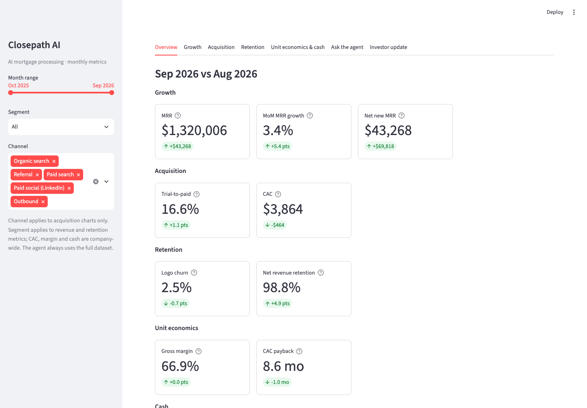

# Startup Metrics Copilot: Closepath AI

A Streamlit dashboard of 10 core SaaS metrics for **Closepath AI**, a fictional AI mortgage-processing startup, plus a Claude agent that investigates metric changes and drafts a monthly investor update.

The data is 12 months of seeded synthetic history (Oct 2025 to Sep 2026) with three planted stories. The agent has to find them from the data alone, through read-only tools, without seeing the answer key.



## Quick start

```bash
uv venv && uv pip install -r requirements.txt      # or: python -m venv .venv && pip install -r requirements.txt
cp .env.example .env                               # add your ANTHROPIC_API_KEY
uv run python data/generate_data.py                # regenerate the CSVs (already committed; output is identical)
uv run pytest                                      # metric, story, and tool tests
uv run streamlit run app.py
```

The dashboard tabs work without an API key. The two agent tabs need `ANTHROPIC_API_KEY`. The model comes from `LLM_MODEL` and defaults to `claude-opus-5-5`.

## How it fits together

```
data/generate_data.py  ──writes──▶  data/*.csv, company.json
                                        │
                                   metrics.py         one pure function per metric, plus a METRICS registry
                                   │        │
                              app.py      agent.py    7 read-only tools → LangGraph ReAct agent (Claude)
                          (dashboard)       │
                                        prompts.py    system rules + investor update task
```

- **`metrics.py` is the single source of numbers.** The dashboard and the agent's tools both call it, and tests check it against a hand-built fixture and an independent pandas calculation.
- **The agent never sees raw data.** It can only call `list_metrics`, `get_metric`, `get_mrr_bridge`, `top_account_changes`, `compare_periods`, `detect_anomalies`, and `runway_scenario`. Each tool returns compact JSON with a `unit` field. There is a cap of 15 tool calls per request.
- **Every answer has an "Agent trace"** listing each tool call, its arguments, and its result, so every number can be checked.
- **`answer_key.md` and the generator's `STORIES` dict are never read by the app or agent.** A test enforces this.

## The 10 metrics

| Category | Metrics |
| --- | --- |
| Growth | MRR (and ARR), MoM MRR growth, net new MRR (MRR bridge) |
| Acquisition | Trial-to-paid conversion, CAC (marketing spend only) |
| Retention | Logo churn, net revenue retention (monthly) |
| Unit economics | Gross margin, CAC payback |
| Cash | Net burn and runway |

Exact formulas are in `metrics.py` (`METRICS` registry) and in each KPI card's tooltip.

## Tests

| File | What it checks |
| --- | --- |
| `tests/test_stories.py` | The 3 planted stories are strong enough to detect (9 checks from the spec) |
| `tests/test_metrics.py` | All 10 metrics on a 4-account fixture with known answers; the bridge sums to the cent; cash rolls forward; baseline sanity ranges; agreement with the independent pandas calculation; no answer-key access |
| `tests/test_agent_tools.py` | Each story can be found through the tools alone; outputs are plain JSON; the tool budget works; the agent graph builds |

## Changes from the original spec

The spec described a helpdesk SaaS ("Brightdesk"). This build re-themes it as an AI mortgage-processing company, with volume-tier subscriptions, AI inference and human QC as COGS, and larger contracts. Sanity ranges and dollar thresholds were re-scaled, and some story strengths were tuned. `BUILD_LOG.md` records every change and why.
